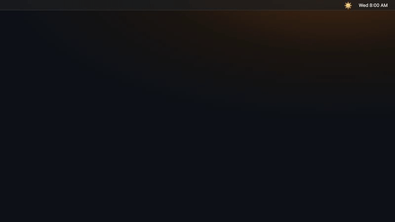
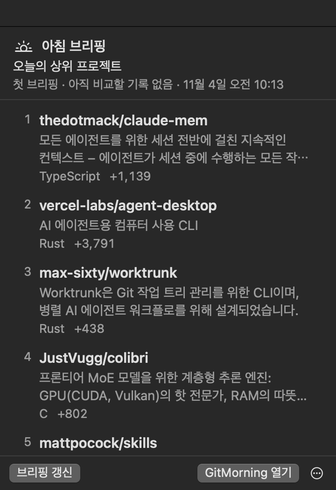
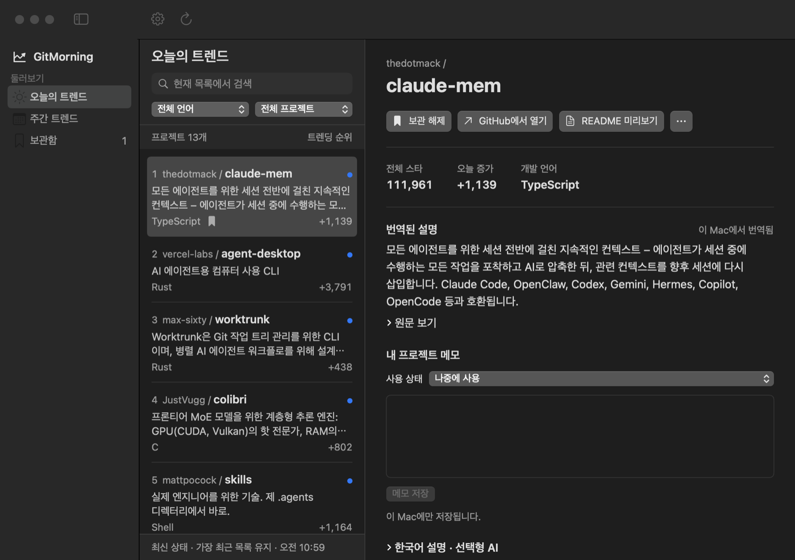

<div align="center">


# GitMorning

**맥 메뉴 막대에서 받아보는 GitHub Trending 아침 브리핑.**

오늘 새로 뜬 프로젝트를 확인하고, 내 언어로 읽고, 써볼 도구를 보관하세요.

[](https://github.com/ddingddong9/gitmorning/releases/latest)
[](#설치)
[](#설치)
[](https://github.com/ddingddong9/gitmorning/releases)
[](LICENSE)

[English](README.md) · **한국어**



</div>

## 왜 GitMorning인가요?

[GitHub Trending](https://github.com/trending)을 매일 확인하기는 쉽지 않고, 목록만 봐서는 어제와 뭐가 달라졌는지 알 수 없습니다. GitMorning이 대신 챙겨 드립니다.

- ☀️ **아침 브리핑.** 하루 한 번, 어제보다 **새로 오르거나 순위가 오른** 프로젝트만 골라 보여줍니다.
- 🌐 **내 언어로.** 프로젝트 설명을 맥 안에서 번역해서 중국어·영어 설명도 한국어로 읽을 수 있습니다.
- 🔖 **눈여겨본 도구 기억하기.** 메모와 사용 상태(*나중에 사용 → 사용해 보는 중 → 사용 중*)와 함께 보관하고, Trending에서 내려가도 남아 있습니다.
- 🔒 **설정할 것 없음.** 계정, API 키, 구독이 필요 없고 데이터는 맥에만 저장됩니다.

## 기능



- 메뉴 막대 **아침 브리핑**, 원하는 시각에 알림(선택)
- **일간·주간 트렌드:** 원래 순위, 전체 Star, 증가량
- **언어별 목록:** 전체, Python, TypeScript, JavaScript, Swift, Go, Rust
- **지난 방문 이후**, 읽지 않음, 숨김 필터
- Apple 기기 내 번역으로 **설명 자동 번역** (macOS 15 이상)
- 앱 안에서 **README 미리보기**
- Apple Intelligence로 만드는 **한국어 설명 (선택)** (macOS 26 이상)
- **검색**, 라이트·다크 모드, 큰 글자, 단축키
- 직접 승인하는 **앱 내 업데이트**

<br clear="right" />

## 설치

```sh
brew tap ddingddong9/gitmorning https://github.com/ddingddong9/gitmorning
brew trust ddingddong9/gitmorning   # Homebrew 7 이상은 외부 tap을 한 번 신뢰해야 합니다
brew install --cask gitmorning
```

또는 [최신 릴리스](https://github.com/ddingddong9/gitmorning/releases/latest)에서 ZIP을 받아 **GitMorning.app**을 응용 프로그램 폴더로 옮기세요.

Apple Silicon 맥, macOS 14 이상에서 동작합니다.

> [!NOTE]
> 아직 Apple 공증을 받지 않아 첫 실행 때 macOS가 막을 수 있습니다. **시스템 설정 → 개인정보 보호 및 보안**에서 **그래도 열기**를 눌러 주세요.

## 사용법



GitMorning을 열고 **오늘의 트렌드**에서 프로젝트를 누르세요. **설정 → 아침 브리핑 → 로그인 시 열기**를 켜 두면 매일 아침 새 브리핑이 준비됩니다.

| 단축키 | 동작 |
| --- | --- |
| `⌘F` | 목록 검색 |
| `⌘D` | 보관·해제 |
| `⇧⌘O` | GitHub에서 열기 |
| `⌘R` | 새로고침 |
| `⌘,` | 설정 |

업데이트는 앱이 알려줄 때 설치하거나 `brew upgrade --cask gitmorning`으로 할 수 있습니다.

## 개인정보

보관함, 메모, 번역, 설명은 맥에만 저장됩니다. 계정, 광고, 사용 기록 수집이 없습니다. 목록은 이 저장소의 공개 데이터(`feed/`, GitHub Trending에서 1시간마다 갱신)에서 가져오고, 받을 수 없으면 GitHub에서 직접 읽습니다.

## 소스에서 빌드

GitMorning은 Xcode 프로젝트 없는 SwiftPM 앱입니다. macOS 14 이상에서 Xcode나 Command Line Tools로 빌드할 수 있습니다.

```sh
git clone https://github.com/ddingddong9/gitmorning && cd gitmorning
GITMORNING_CORE_ONLY=1 swift build        # 업데이트 기능 없이 빌드
zsh scripts/build-app.sh                   # dist/에 GitMorning.app 생성
python3 -m unittest discover -s pipeline/tests
```

| 경로 | 내용 |
| --- | --- |
| `Sources/GitMorningCore` | 파싱, 피드·README 읽기, 아침 브리핑, 캐시 (UI 없음) |
| `Sources/GitMorning` | SwiftUI 앱, 메뉴 막대 브리핑, 설정 |
| `pipeline/` | Python 트렌딩 수집기, README 발췌, 상태 점검 |
| `feed/` | GitHub Pages에 올리는 공유 피드 생성 |
| `scripts/` | 앱 번들·릴리스, `check-*.swift` 검사 |
| `Casks/` | Homebrew Cask |

자세한 내용은 [docs/DEVELOPMENT.md](docs/DEVELOPMENT.md), [docs/discovery.md](docs/discovery.md), [CONTRIBUTING.md](CONTRIBUTING.md)를 참고하세요.

## 피드백

버그나 아이디어가 있으면 [이슈를 남기거나](https://github.com/ddingddong9/gitmorning/issues) PR을 보내 주세요. GitMorning은 [MIT 라이선스](LICENSE)입니다. 도움이 됐다면 ⭐를 눌러 다른 사람도 찾을 수 있게 해 주세요.
