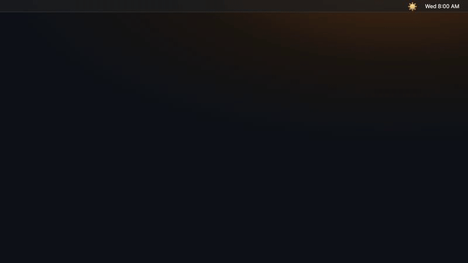
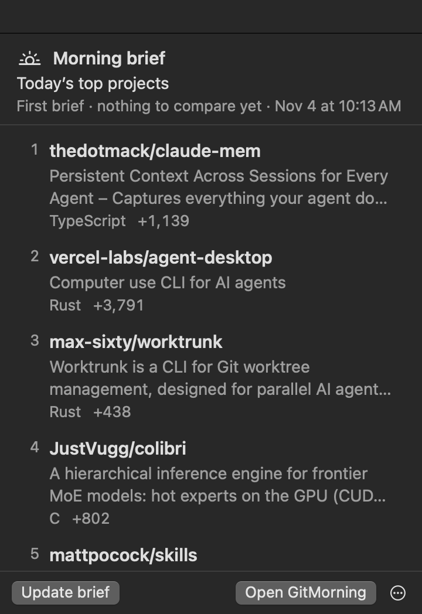
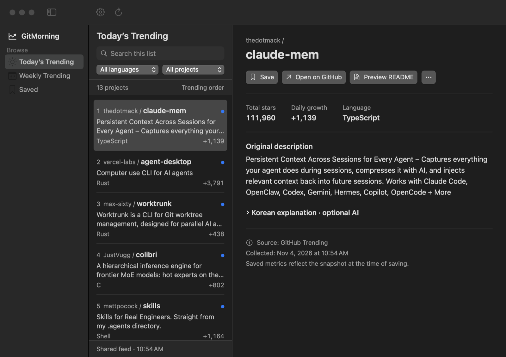

<div align="center">


# GitMorning

**Your morning digest of GitHub Trending, right in the Mac menu bar.**

See what's new and rising today, read what each project does in your language, and save the tools you want to try.

[](https://github.com/ddingddong9/gitmorning/releases/latest)
[](#install)
[](#install)
[](https://github.com/ddingddong9/gitmorning/releases)
[](LICENSE)

**English** · [한국어](README.ko.md)



</div>

## Why GitMorning?

Checking [GitHub Trending](https://github.com/trending) every day is easy to forget, and the list doesn't tell you what changed since yesterday. GitMorning does that part for you:

- ☀️ **A morning brief.** Once a day it lists only the projects that are **new or climbing** since yesterday.
- 🌐 **In your language.** Descriptions are translated on your Mac, so a Chinese or Japanese README summary reads in English or Korean.
- 🔖 **Remember what caught your eye.** Save projects with a note and a status (*Try later → Testing → In use*), even after they drop off Trending.
- 🔒 **Nothing to set up.** No account, API key, or subscription. Your data stays on your Mac.

## Features



- **Morning brief** in the menu bar, with an optional notification at the time you choose
- **Daily & weekly Trending** with original rank, total stars, and growth
- **Languages:** all, Python, TypeScript, JavaScript, Swift, Go, Rust
- **Since last visit**, unread, and hidden filters
- **Automatic translation** of descriptions with Apple's on-device translation (macOS 15+)
- **README preview** without leaving the app
- **Korean explanations (optional)** generated on-device with Apple Intelligence (macOS 26+)
- **Search**, light & dark mode, larger text, keyboard shortcuts
- **In-app updates** you approve

<br clear="right" />

## Install

```sh
brew tap ddingddong9/gitmorning https://github.com/ddingddong9/gitmorning
brew trust ddingddong9/gitmorning   # Homebrew 7+ asks you to trust a third-party tap once
brew install --cask gitmorning
```

Or download the ZIP from the [latest release](https://github.com/ddingddong9/gitmorning/releases/latest) and move **GitMorning.app** to Applications.

Requires macOS 14 or later on Apple Silicon.

> [!NOTE]
> GitMorning is not notarized by Apple yet, so macOS may block the first launch. Open **System Settings → Privacy & Security** and choose **Open Anyway**.

## Usage



Open GitMorning, pick **Today's Trending**, and click a project. Turn on **Settings → Morning brief → Open at login** to get a fresh brief every morning.

| Shortcut | Action |
| --- | --- |
| `⌘F` | Search the list |
| `⌘D` | Save / unsave |
| `⇧⌘O` | Open on GitHub |
| `⌘R` | Refresh |
| `⌘,` | Settings |

Update from the app when it asks, or with `brew upgrade --cask gitmorning`.

## Privacy

Saved projects, notes, translations, and explanations stay on your Mac. No account, ads, or analytics. Lists come from a public feed in this repository that is refreshed hourly from GitHub Trending (`feed/`), with GitHub itself as a fallback.

## Build from source

GitMorning is a SwiftPM app (no Xcode project). With Xcode or the Command Line Tools on macOS 14+:

```sh
git clone https://github.com/ddingddong9/gitmorning && cd gitmorning
GITMORNING_CORE_ONLY=1 swift build        # app without the updater
zsh scripts/build-app.sh                   # GitMorning.app in dist/
python3 -m unittest discover -s pipeline/tests
```

| Path | What it is |
| --- | --- |
| `Sources/GitMorningCore` | Parsing, feed and README readers, morning brief, caches (no UI) |
| `Sources/GitMorning` | SwiftUI app, menu bar brief, settings |
| `pipeline/` | Python Trending collector, README excerpts, canary |
| `feed/` | Builds the shared feed published to GitHub Pages |
| `scripts/` | App bundle, release, and `check-*.swift` checks |
| `Casks/` | Homebrew cask |

More in [docs/DEVELOPMENT.md](docs/DEVELOPMENT.md), [docs/discovery.md](docs/discovery.md), and [CONTRIBUTING.md](CONTRIBUTING.md).

## Feedback

Found a bug or have an idea? [Open an issue](https://github.com/ddingddong9/gitmorning/issues) or send a pull request. GitMorning is [MIT-licensed](LICENSE). If GitMorning helps you, a ⭐ helps others find it.
